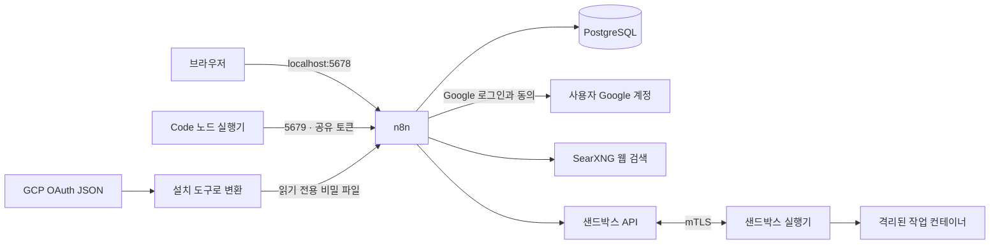

# n8n Compose

n8n, AI 코드 실행 샌드박스, 웹 검색을 Docker Compose로 설치하는 한국어 배포 템플릿입니다.
GCP에서 내려받은 Google OAuth JSON을 넣으면 사용자가 Client ID·Secret 입력 없이 Google 계정을 연결하도록 설정할 수 있습니다.

## 준비물

- Docker Desktop 또는 Docker Engine + Docker Compose v2.24 이상
- Python 3.10 이상. Git은 저장소를 clone할 때만 필요하며 ZIP 다운로드로 생략할 수 있습니다.
- 샌드박스 포함 시 최소 2 vCPU·4 GB RAM. 이미지 저장 공간과 실행 여유를 고려해 8 GB RAM 이상 권장
- Google 연결을 쓸 경우 Google Cloud의 **웹 애플리케이션 OAuth 클라이언트 JSON**
- AI 어시스턴트를 쓸 경우 OpenAI 호환 모델 endpoint와 API 키

macOS·Windows는 Docker Desktop을 먼저 실행합니다. **Windows는 PowerShell에서 바로 진행합니다.**
PowerShell 사용에는 Ubuntu 설치나 WSL Integration 설정이 필요하지 않습니다. Docker Desktop의 WSL 2 실행 기반만 준비합니다.
Windows 처음 설치는 [Docker Desktop + PowerShell 설치 가이드](docs/WINDOWS.md)를 따라 진행하세요.
아래 공통 예제의 `python3`는 Windows에서 `py -3`로 바꿉니다. Python 실행 명령이 `python`인 환경에서는 `python`을 사용합니다.

## 1. 내려받기

```bash
git clone https://github.com/jeong-wooseok/n8n-compose.git
cd n8n-compose
```

Git을 설치하지 않았다면 저장소의 **Code → Download ZIP**으로 내려받고 압축을 푼 뒤, README.md가 있는 프로젝트 폴더에서 진행합니다.

## 2. 설정 만들기

샌드박스와 웹 검색을 포함하는 설치입니다.

```bash
python3 scripts/setup.py --sandbox
```

각 설치에 서로 다른 비밀번호와 암호화 키를 만들고 `.env`에 저장합니다.
다시 실행해도 기존 `.env`를 덮어쓰거나 암호화 키를 바꾸지 않습니다.
처음에는 Google 설정이 비어 있어도 n8n을 시작할 수 있습니다.

예제 설정은 자주 바꾸는 값과 자동 생성할 비밀값 22개로 구성됩니다.
이미지 기본값과 드문 설정은 Compose에 두고, 필요할 때만 `.env`에서 재정의합니다.
n8n과 Code 실행기는 `N8N_VERSION=latest`, 샌드박스 이미지는 `latest`를 기본으로 사용합니다.
업데이트가 필요할 때 `docker compose pull` 후 `docker compose up -d`로 적용합니다.
[설정 항목과 이미지 업데이트 방법](docs/CONFIGURATION.md)을 참고하세요.

AI 어시스턴트까지 사용할 때는 `.env`의 다음 세 항목을 채웁니다.

```dotenv
N8N_INSTANCE_AI_MODEL=your-model-name
N8N_INSTANCE_AI_MODEL_URL=https://your-provider.example/v1
N8N_INSTANCE_AI_MODEL_API_KEY=your-private-api-key
```

모델 이름·URL·키는 선택한 공급자의 값을 사용합니다. 일반 워크플로 AI 노드의 자격정보는 n8n 화면에서 별도로 만듭니다.

## 3. Google JSON 넣기

Google Cloud Console에서 다운로드한 파일 경로를 지정합니다.

```bash
python3 scripts/setup.py --google-oauth /path/to/client_secret.json
```

파일을 `.local/google-client.json`으로 넣었다면 경로 없이 실행해도 됩니다.

```bash
python3 scripts/setup.py --google-oauth
```

설치 도구가 n8n용 `.local/google-oauth.json`으로 변환하고 n8n에 읽기 전용으로 연결합니다.
이 파일들과 `.env`는 GitHub에 올라가지 않습니다.

Google Cloud에서는 다음 콜백 주소를 OAuth 클라이언트의 **승인된 리디렉션 URI**에 등록해야 합니다.

```text
http://localhost:5678/rest/oauth2-credential/callback
```

사용할 API, 동의 화면과 테스트 사용자도 설정해야 합니다. [Google 연결 가이드](docs/GOOGLE_OAUTH.md)를 따라 진행합니다.

## 4. 시작하기

```bash
docker compose config --quiet
docker compose pull
```

Linux에서 설치 계정의 UID가 1000이 아니면 공유 폴더의 컨테이너 쓰기 권한을 먼저 준비합니다.
다음 명령은 공유 폴더 하나의 소유권만 설정하고 종료합니다.

```bash
docker compose run --rm --no-deps --user 0:0 --entrypoint sh n8n -c 'chown 1000:1000 /data/shared && chmod 0750 /data/shared'
```

그다음 서비스를 시작합니다. macOS·Windows에서 공유 폴더 권한이 이미 맞으면 준비 명령은 생략할 수 있습니다.

```bash
docker compose up -d --wait --wait-timeout 600
python3 scripts/check.py
```

첫 설치에서는 이미지 다운로드와 샌드박스 내부 Docker 시작에 시간이 걸립니다.

| 화면 | 주소 | 처음 할 일 |
| --- | --- | --- |
| n8n | http://localhost:5678 | 소유자 계정 생성 |
| 웹 검색 | http://localhost:8888 | 검색어를 입력해 결과 확인 |
| Google 연결 | n8n → Credentials → Google Sheets/Drive 등 | Google 연결 버튼으로 본인 계정 로그인 |

`sandbox-certs`가 `Exited (0)`으로 보이는 것은 정상입니다. 인증서 생성 후 종료되는 일회성 서비스입니다.
AI 샌드박스는 n8n의 Code 노드 실행기와 별개의 서비스입니다.

## 구성



| 구분 | 서비스 | 용도 |
| --- | --- | --- |
| 항상 사용 | `n8n`, `postgres`, `task-runners` | 워크플로·데이터·Code 노드 |
| 기본 검색 프로필 | `searxng` | JSON 검색 API, AI 웹 검색 |
| `--sandbox` 설치 | `sandbox-certs`, `sandbox-api`, `sandbox-runner-1` | AI 어시스턴트 코드 실행 |
| `memory` 프로필 | `redis` | 워크플로 메모리·캐시 |
| `vector` 프로필 | `qdrant` | RAG 벡터 저장 |
| `tools` 프로필 | `redis`, `redisinsight` | Redis 관리 화면 |

샌드박스 없이 n8n과 웹 검색만 필요하면 새 폴더에서 `python3 scripts/setup.py`를 사용합니다.
서비스 데이터는 프로젝트별 Docker volume에 저장하고, 공유 파일은 `data/shared/`에 둡니다.
실제 비밀번호, DB, 원본 백업은 저장소에 포함하지 않습니다.

## 중지·재시작·로그

```bash
docker compose stop
docker compose up -d --wait --wait-timeout 600
docker compose ps -a
docker compose logs --tail 100 n8n
```

`docker compose down`은 컨테이너를 제거하고 데이터 volume은 보존합니다.
**`down -v`는 데이터를 삭제하므로 일상적인 중지나 업데이트에 사용하지 않습니다.**

## 자세한 가이드

- [Google JSON → 사용자별 Google 로그인](docs/GOOGLE_OAUTH.md)
- [웹 검색·샌드박스·Redis·Qdrant 사용](docs/FEATURES.md)
- [HTTPS·백업·복구·업데이트·기존 서버 이전](docs/OPERATIONS.md)
- [간단한 설정·이미지 버전 선택·이전 .env 전환](docs/CONFIGURATION.md)
- [원본 구성 분석과 제거·수정 이유](docs/ANALYSIS.md)

## 배포 범위

기본 주소는 이 PC에서만 접근하도록 설정되어 있습니다. 서버 공개 전에는 [HTTPS 설정](docs/OPERATIONS.md#https와-외부-접속)을 적용합니다.
샌드박스 실행기는 `privileged` Docker-in-Docker를 사용합니다. 공식 예시도 이 번들 샌드박스를 개발·테스트 용도로 안내합니다.
공유 운영 환경의 샌드박스 제공 방식은 [n8n 공식 배포 문서](https://docs.n8n.io/hosting/installation/server-setups/digital-ocean/)를 확인합니다.

이 저장소는 구성 템플릿입니다. n8n·SearXNG 등 각 소프트웨어의 라이선스와 이용 조건은 해당 프로젝트를 따릅니다.
GitHub Actions는 설정 검사와 기본 n8n 기동을 검증하며, 실제 Google 동의·모델 과금 호출은 자동 수행하지 않습니다.
